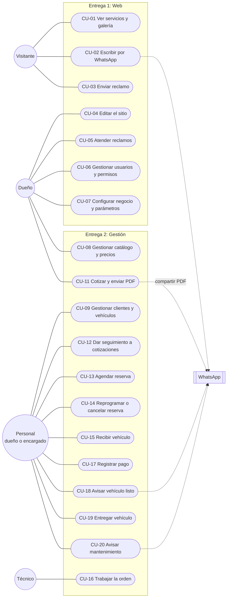

# Casos de uso — TocTar Detailing (Web + Gestión)

- **Versión:** borrador 1 · 9 de octubre de 2026
- **Base:** `04-requerimientos/requerimientos.md` (aprobado)
- **Estado:** pendiente de validación del dueño

## Supuestos respondidos por el dueño (14 de octubre de 2026)

| # | Supuesto | Respuesta | Casos afectados |
|---|---|---|---|
| S-1 | El técnico ve solo las órdenes asignadas a él y no ve precios ni pagos. | Confirmado | CU-16 |
| S-2 | Un vehículo con saldo pendiente solo se entrega con autorización del dueño. | **Ajustado:** el dueño o "la persona a cargo del taller". Se implementa como permiso del encargado: "autorizar entrega con saldo" | CU-19 |
| S-3 | La agenda se maneja por día (no por hora); la hora de ingreso es solo una nota. | Confirmado: por día y espacio | CU-13 |
| S-4 | Los reclamos llegan al panel; el dueño los ve en la pantalla de inicio. | **Ajustado:** también los ve el encargado que tenga el módulo de reclamos | CU-03, CU-05 |
| S-5 | La validez por defecto de la cotización es 15 días, editable en la configuración. | **Ajustado:** la validez se define en cada cotización; la configuración solo da el valor sugerido | CU-11 |

## Actores

| Actor | Hereda de | Notas |
|---|---|---|
| Visitante | — | Sin cuenta |
| Personal | — | Actor abstracto: lo que hacen dueño y encargado |
| Encargado | Personal | Solo los módulos que el dueño le habilite |
| Dueño | Personal | Además, cotiza, configura y autoriza |
| Técnico | — | Solo sus órdenes |
| WhatsApp | — | Sistema externo: se abre con el mensaje escrito, el envío lo hace la persona |

## Diagrama general

Todos los usuarios del panel inician sesión (CU-00). El dueño también puede hacer todo lo del personal.

## Lista de casos de uso

| Código | Caso de uso | Actor | Entrega | Requisitos |
|---|---|---|---|---|
| CU-00 | Iniciar y cerrar sesión | Dueño, encargado, técnico | 1 | RF-14 |
| CU-01 | Ver servicios y galería | Visitante | 1 | RF-01 a RF-06, RF-09 |
| CU-02 | Escribir por WhatsApp desde el sitio | Visitante | 1 | RF-08 |
| CU-03 | Enviar un reclamo o pedido de garantía | Visitante | 1 | RF-07 |
| CU-04 | Editar textos, servicios y galería del sitio | Dueño | 1 | RF-10 a RF-12 |
| CU-05 | Atender reclamos | Dueño | 1 | RF-13 |
| CU-06 | Gestionar usuarios y permisos | Dueño | 1 | RF-15, RF-16 |
| CU-07 | Configurar negocio y parámetros | Dueño | 1 | RF-17, RF-18 |
| CU-08 | Gestionar catálogo y precios | Dueño | 2 | RF-25 a RF-28 |
| CU-09 | Gestionar clientes y vehículos | Personal | 2 | RF-20 a RF-24 |
| CU-10 | Registrar una consulta (reemplazado por CU-11, pedido 23) | — | 2 | — |
| CU-11 | Cotizar y enviar el PDF | Dueño o encargado con "Cotizaciones" | 2 | RF-29, RF-31 a RF-34 |
| CU-12 | Dar seguimiento a cotizaciones | Personal | 2 | RF-30, RF-35 |
| CU-13 | Agendar una reserva | Personal | 2 | RF-36 a RF-38 |
| CU-14 | Reprogramar o cancelar una reserva | Personal | 2 | RF-39 |
| CU-15 | Recibir el vehículo (abrir la orden) | Personal | 2 | RF-40 |
| CU-16 | Trabajar la orden | Técnico | 2 | RF-41, RF-42 |
| CU-17 | Registrar un pago | Personal | 2 | RF-45 a RF-47 |
| CU-18 | Avisar que el vehículo está listo | Personal | 2 | RF-48 |
| CU-19 | Entregar el vehículo | Personal | 2 | RF-41, RF-43, RF-44, RF-49 |
| CU-20 | Avisar el mantenimiento | Personal | 2 | RF-49, RF-50 |

## Detalle de los casos principales

### CU-10 Registrar una consulta (reemplazado)

Desde el pedido 23 (01/11/2026) no hay consulta aparte: el dueño pidió cotizar directo. Registrar al cliente y a su vehículo sin salir de la pantalla pasó a CU-11. Especificación: `08-desarrollo/etapas/P23-cotizacion-directa.md`.

### CU-11 Cotizar y enviar el PDF

- **Actor:** dueño, o encargado con el permiso "Cotizaciones" (RN-01, pedido 24).
- **Precondición:** sesión iniciada.
- **Flujo principal:**
    1. El actor elige "Nueva cotización" y busca al cliente por nombre, teléfono o placa.
    2. Elige su vehículo; agrega servicios y variantes, y el sistema sugiere el precio según el tamaño del vehículo.
    3. Ajusta precios o descuento si quiere; el sistema calcula el total y sugiere el adelanto y la validez (S-5).
    4. Indica cómo se cotizó: en persona o por fotos.
    5. Guarda; el sistema genera el PDF y la cotización queda "pendiente".
    6. Comparte el PDF: en el celular abre el menú de compartir (WhatsApp, correo); en la PC lo descarga o imprime.
- **Alternativos:**
    - 1a. El cliente no existe: lo registra en la misma pantalla (nombre y WhatsApp). Si el teléfono ya existe, el sistema lo avisa y ofrece cotizarle a ese cliente (RF-23).
    - 2a. El vehículo no existe: lo registra en la misma pantalla con placa y tamaño como mínimo.
    - 2b. La variante no tiene precio (PPF, chapa): el actor escribe el precio.
    - 4a. Cotizada por fotos: el PDF indica que es un estimado (RN-03).
    - 7a. Se cambia una cotización ya enviada: se crea una versión nueva con el mismo número; la anterior queda igual (RN-02).
- **Postcondición:** cotización pendiente, con precios fijos y su PDF.

### CU-13 Agendar una reserva

- **Actor:** personal.
- **Precondición:** cotización confirmada por el cliente, o cliente registrado (reserva directa).
- **Flujo principal:**
    1. El personal marca la cotización como confirmada y elige "Agendar".
    2. El sistema propone la duración según el catálogo.
    3. El personal elige la fecha de ingreso y el espacio en el tablero; el sistema muestra solo los espacios libres en esos días (RN-06).
    4. Asigna un técnico (opcional).
    5. Registra el adelanto (CU-17); el monto sugerido es editable (RN-04).
    6. El sistema guarda la reserva y la consulta pasa a "confirmado".
- **Alternativos:**
    - 1a. Reserva directa sin cotización (por ejemplo, un mantenimiento): elige cliente, vehículo y servicio con su precio de catálogo.
    - 3a. No hay espacio libre en la fecha pedida: el sistema lo indica y el personal elige otra fecha.
    - 5a. El cliente no deja adelanto: la reserva se guarda con una marca de "sin adelanto".
- **Postcondición:** la reserva ocupa el espacio en el tablero.

### CU-15 Recibir el vehículo

- **Actor:** personal.
- **Precondición:** reserva para hoy (o vehículo sin reserva que entra en el momento).
- **Flujo principal:**
    1. El personal abre la reserva y elige "Recibir".
    2. Toma fotos del vehículo y anota observaciones (rayones, golpes, objetos dentro).
    3. El sistema crea la orden en estado "recibido" con el precio cotizado.
- **Postcondición:** el técnico asignado ve la orden.

### CU-16 Trabajar la orden

- **Actor:** técnico.
- **Precondición:** orden asignada al técnico (S-1).
- **Flujo principal:**
    1. El técnico abre sus órdenes y elige una.
    2. La pasa a "en proceso" y sube fotos de antes.
    3. Registra avances y notas; sube fotos durante el trabajo.
    4. Al terminar, sube fotos de después y marca "listo".
- **Postcondición:** el personal ve la orden como lista y sin avisar.

### CU-19 Entregar el vehículo

- **Actor:** personal; dueño para autorizar.
- **Precondición:** orden en estado "listo".
- **Flujo principal:**
    1. El personal abre la orden; el sistema muestra precio final, pagos y saldo.
    2. Registra el pago del saldo (CU-17).
    3. Marca "entregado".
    4. Si el servicio genera mantenimiento, el sistema calcula la fecha del próximo (RN-08).
- **Alternativos:**
    - 1a. Hubo trabajos adicionales: el dueño los suma y el precio final cambia (RF-43).
    - 2a. El cliente no paga todo: solo el dueño o un encargado con el permiso "autorizar entrega con saldo" puede marcar la entrega con saldo pendiente (RN-13, S-2).
    - 4a. Deseable: el dueño elige fotos de la orden para la galería del sitio (RF-44).
- **Postcondición:** orden cerrada; el saldo queda en cero o en la lista de saldos pendientes.

### CU-20 Avisar el mantenimiento

- **Actor:** personal.
- **Precondición:** hay mantenimientos por vencer o vencidos.
- **Flujo principal:**
    1. El personal abre "Mantenimientos".
    2. El sistema lista los clientes con mantenimiento por vencer y vencido, ordenados por fecha.
    3. El personal toca "Avisar"; se abre WhatsApp con el mensaje escrito.
    4. Vuelve al sistema y marca el resultado: avisado, agendado o no interesado.
- **Alternativos:**
    - 4a. El cliente quiere agendar: el personal pasa a CU-13 con reserva directa del servicio de mantenimiento.
- **Postcondición:** el recordatorio queda registrado con su resultado.
