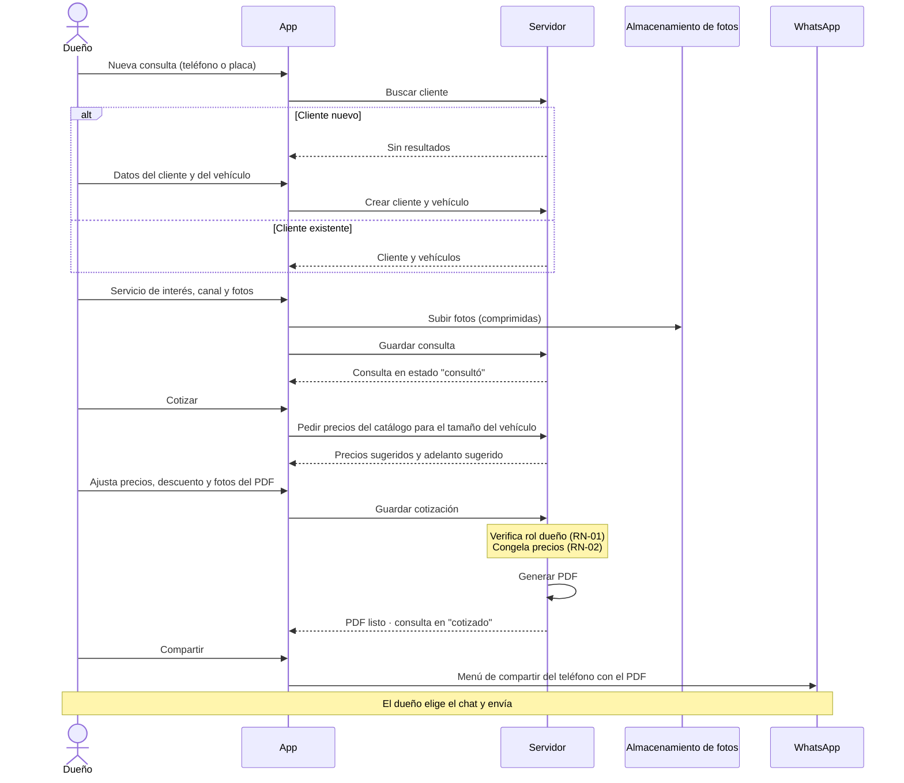
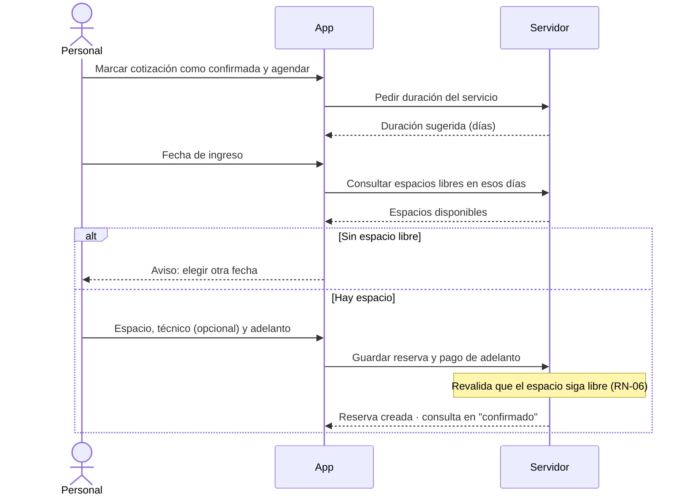
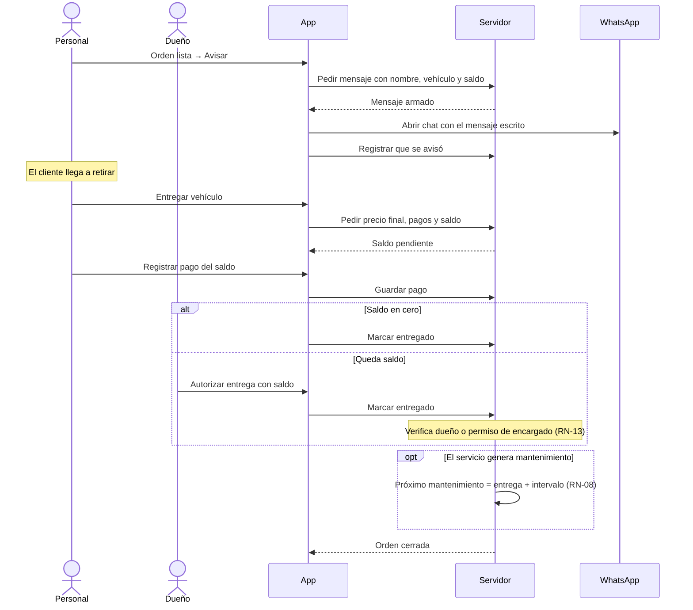
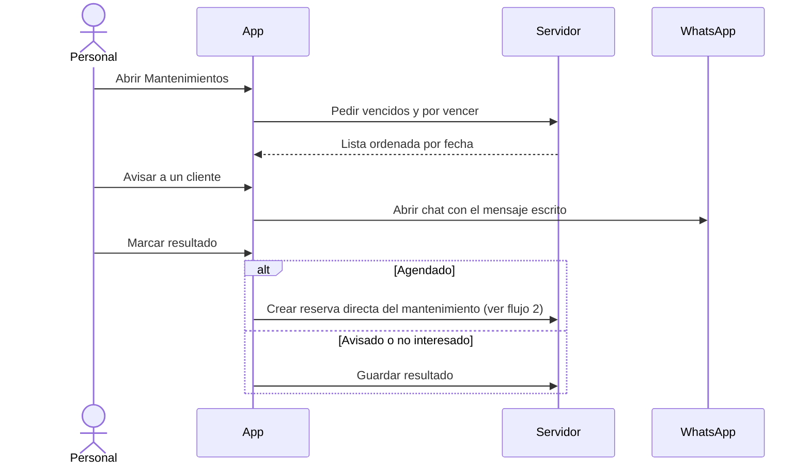

# Diagramas de secuencia — flujos críticos

- **Versión:** borrador 1 · 9 de octubre de 2026
- **Base:** `05-analisis/casos-de-uso/casos-de-uso.md`

Cubren el recorrido completo de un trabajo: consulta → cotización → reserva → ingreso → trabajo → aviso → entrega → mantenimiento. Están a nivel de análisis: "Servidor" es el sistema sin entrar en tecnologías, que se definen en el diseño (etapa 6).

**Participantes:** el actor, la App (PWA en el celular o la PC), el Servidor, el Almacenamiento de fotos y WhatsApp (el teléfono del usuario).

## 1. Consulta y cotización en PDF (CU-10, CU-11)

## 2. Reserva con adelanto (CU-13, CU-17)

La segunda validación en el servidor evita que dos personas reserven el mismo espacio al mismo tiempo.

## 3. Ingreso del vehículo y trabajo del técnico (CU-15, CU-16)

```mermaid
sequenceDiagram
    actor P as Personal
    actor T as Técnico
    participant A as App
    participant S as Servidor
    participant F as Almacenamiento de fotos

    P->>A: Recibir vehículo (desde la reserva)
    P->>A: Fotos de ingreso y observaciones
    A->>F: Subir fotos
    A->>S: Crear orden
    S-->>A: Orden en "recibido"

    T->>A: Mis órdenes
    A->>S: Pedir órdenes del técnico
    Note over S: Solo las asignadas, sin precios (RN-12)
    S-->>A: Lista de órdenes
    T->>A: Pasar a "en proceso" y subir fotos de antes
    A->>F: Subir fotos
    A->>S: Actualizar orden
    loop Durante el trabajo
        T->>A: Avances, notas y fotos
        A->>S: Actualizar orden
    end
    T->>A: Fotos de después y marcar "listo"
    A->>S: Orden en "listo"
```

## 4. Aviso, cobro del saldo y entrega (CU-18, CU-17, CU-19)

## 5. Recordatorio de mantenimiento (CU-20)

No hay envío automático: el sistema prepara el mensaje y la persona lo envía. Los avisos automáticos (API de WhatsApp) quedan fuera del alcance.
