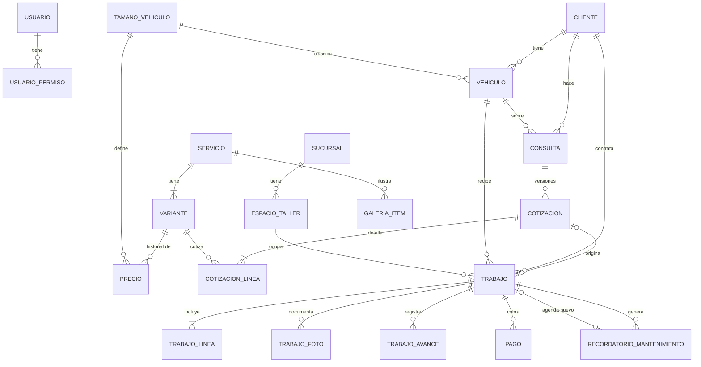

# Modelo de datos — TocTar Detailing

- **Versión:** borrador 1 · 10 de octubre de 2026
- **Base:** requerimientos aprobados y análisis (etapa 5)
- **Motor:** PostgreSQL

El modelo cubre el **Sistema completo**, aunque hoy se programa solo Web + Gestión. Las tablas marcadas como *Futuro* no se crean todavía, pero las actuales ya dejan su lugar: sumar inventario, planilla, caja, factura SIAT o una segunda sucursal no obliga a rehacer tablas (RNF-13).

## Decisiones de diseño

| # | Decisión | Por qué |
|---|---|---|
| D-1 | **Reserva y orden son una sola tabla: `trabajo`**, con estados agendado → recibido → en proceso → listo → entregado (o cancelado). | El adelanto se paga en la reserva y el saldo en la orden; con una sola tabla, pagos, servicios y fotos no se copian ni se desincronizan. En pantalla siguen siendo "reserva" y "orden". |
| D-2 | **Todo servicio tiene al menos una variante** (si no tiene opciones, una llamada "Única"). | Precios, cotizaciones y trabajos siempre apuntan a una variante: una sola regla, sin casos especiales. |
| D-3 | **Los precios no se sobrescriben:** cada cambio es una fila nueva con fecha (`precio`). | Historial de precios (RF-28) gratis. |
| D-4 | **Las líneas de cotización y de trabajo copian descripción y precio.** | Una cotización enviada no cambia si después cambia el catálogo (RN-02). |
| D-5 | **Cruces de agenda imposibles en la base de datos:** restricción de exclusión sobre `(espacio_id, rango de fechas)` para trabajos activos. | RN-06 se cumple aunque dos personas reserven al mismo tiempo. |
| D-6 | **Nada se borra si tiene historial:** campo `activo` o estado `anulado`. | RN-14 y auditoría. |
| D-7 | **`sucursal_id` desde el inicio** en espacios, trabajos y (futuro) caja e inventario. Hoy hay una sola sucursal. | Segunda sucursal sin migración grande. |
| D-8 | **Parámetros como tabla clave-valor validada en código** (`parametro`). | Agregar un parámetro no requiere migración (RNF-11). |
| D-9 | **Montos en `numeric(10,2)`**, fechas de agenda en `date`, marcas de tiempo en `timestamptz` (America/La_Paz al mostrar). | Sin errores de redondeo ni de zona horaria. |
| D-10 | **Archivos en una tabla común (`archivo`)**; el binario va al almacenamiento de fotos, la base guarda solo la referencia. | La base queda liviana y los respaldos son rápidos. |
| D-11 | **El plan de mantenimiento de un vehículo es su fila abierta de `recordatorio_mantenimiento`**, sin tabla aparte: al hacerse queda `hecho` y nace la siguiente con la misma frecuencia. Un índice único parcial impide dos abiertos del mismo vehículo y servicio (pedido 21, 27/10/2026). | El mantenimiento repetido no puede pasar, la historia del plan son sus filas y la lista de Mantenimientos no cambia de forma. |
| D-12 | **La consulta es el encabezado de la cotización** (pedido 23, 01/11/2026): `consulta` agrupa las versiones (`cotizacion`) y lleva el estado comercial (`cotizado` = pendiente, `confirmado` = aceptada, `perdido` = rechazada) y el último movimiento. Ya no se crea en `consulto` ni lleva canal, nota ni archivos; se conserva el nombre de la tabla. | Con versiones (RN-02) hace falta un encabezado, y ya existía: sin mover datos, la agenda y las órdenes siguen apuntando a `consulta_id` y `cotizacion_id`. |
| D-13 | **Dos roles, sin técnico asignado** (pedido 32, 02/11/2026): `usuario.rol` es `dueno` o `encargado`, y lo que hace cada encargado sale de `usuario_permiso` (los perfiles de la pantalla, como Taller, solo marcan casillas). `trabajo` no tiene técnico: quién hizo cada paso queda en `trabajo_avance.usuario_id`, `recibido_por`, `entregado_por` y `trabajo_foto.subido_por`. | En TocTar cuatro personas hacen de todo; asignar un auto a un técnico era un paso que nadie usaba y dejaba a los empleados sin poder recibir ni entregar. |

## Diagrama entidad-relación (núcleo)



Las relaciones con `archivo` (fotos y PDF) y con `usuario` como autor (`created_by`) se omiten del diagrama para que se lea.

## Tablas

Convenciones: `id` es `bigint` autoincremental; todas las tablas tienen `created_at` y, donde corresponde, `updated_at` y `created_by` (usuario). Solo se listan los campos propios.

### Configuración y accesos (entrega 1)

| Tabla | Campos | Notas |
|---|---|---|
| `negocio` | nombre, logo_archivo_id, correo, redes (json), nit, razon_social | Una sola fila |
| `sucursal` | nombre, direccion, lat, lng, horarios (json), telefono_whatsapp, activo | Hoy una fila |
| `parametro` | clave (pk), valor (jsonb) | Adelanto sugerido, validez de cotización, intervalo de mantenimiento, condiciones del PDF, etc. |
| `tamano_vehiculo` | nombre, descripcion, orden, activo | Hoy 5, de compactos a extra grandes; `descripcion` lleva modelos de ejemplo para clasificar el vehículo |
| `espacio_taller` | sucursal_id, nombre, orden, activo | Hoy 3 |
| `usuario` | nombre, nombre_usuario (único), correo (interno), rol (`dueno`, `encargado`, con CHECK; D-13), desactivado | Tabla de Better Auth. La contraseña (hash) va en `cuenta`; `correo` es interno (`<usuario>@usuarios.toctar.local`) porque la librería lo exige; "desactivar" usa el bloqueo de la librería, que cierra las sesiones. Tablas propias de la librería: `sesion`, `cuenta`, `verificacion` (HU-01) |
| `usuario_permiso` | usuario_id, permiso | Solo para encargado (RF-16): un módulo (`sitio`, `reclamos`, `clientes`, `cotizaciones`, `agenda`, `ordenes`, `pagos`, `mantenimientos`) o el permiso `entrega_con_saldo` (RN-13) |
| `plantilla_mensaje` | clave (pk), texto | Los mensajes de WhatsApp que el dueño cambió: "listo", "saldo" y "mantenimiento" (HU-40). Sin fila vale el original, que está en el código |
| `auditoria` | usuario_id, entidad, entidad_id, accion, datos (jsonb) | Cambios en cotizaciones, pagos y precios (RNF-10) |
| `archivo` | clave_almacenamiento, tipo_mime, bytes, ancho, alto | Fotos, videos, logo y PDF |

### Sitio público (entrega 1)

| Tabla | Campos | Notas |
|---|---|---|
| `contenido_pagina` | clave (pk: `inicio`, `nosotros`, `contacto`), datos (jsonb), foto_archivo_id (opcional) | Textos editables (RF-10); la foto es la del taller de la portada (D-10) |
| `faq` | pregunta, respuesta, orden, visible | |
| `galeria_item` | servicio_id, foto_antes_id, foto_despues_id, descripcion, orden, visible, trabajo_id (opcional) | `trabajo_id` cuando la foto viene de una orden (RF-44) |
| `reclamo` | nombre, telefono, placa, servicio_id, fecha_aproximada, descripcion, estado (`pendiente`, `atendido`), nota_atencion, atendido_por, atendido_at | |
| `reclamo_archivo` | reclamo_id, archivo_id | Hasta 3 |

### Catálogo (servicios en entrega 1, precios en entrega 2)

| Tabla | Campos | Notas |
|---|---|---|
| `servicio_foto` | servicio_id, seccion (proceso u opciones; una por sección), archivo_id | La foto al lado de una sección de la página de un servicio (pedido de la demo del 24/10). Decorativa |
| `servicio` | nombre, slug (único), resumen, descripcion (sin uso desde el 24/10: la página muestra el resumen), beneficios (jsonb: texto e ícono), pasos (jsonb), opciones_en_escalera, foto_archivo_id, orden, visible_sitio, activo, duracion_dias, mantenimiento_servicio_id, mantenimiento_meses | Un solo registro para el sitio y el catálogo. Su mantenimiento (pedido 21): el servicio que se agenda (puede ser él mismo) y cada cuántos meses, los dos o ninguno |
| `variante` | servicio_id, nombre, descripcion, orden, duracion_dias (opcional, pisa la del servicio), activo | D-2 |
| `precio` | variante_id, tamano_id, monto (nulo = según evaluación), vigente_desde | D-3; el vigente es el de fecha más reciente |

### Clientes (entrega 2)

| Tabla | Campos | Notas |
|---|---|---|
| `cliente` | nombre, telefono (único), correo, nit, razon_social, notas, activo | NIT para SIAT futura |
| `vehiculo` | cliente_id, placa (única), marca, modelo, anio, color, tamano_id, activo | |

### Cotizaciones (entrega 2; pedido 23)

| Tabla | Campos | Notas |
|---|---|---|
| `consulta` | cliente_id, vehiculo_id, servicio_id, canal (nulo desde el pedido 23), estado (`cotizado`, `confirmado`, `perdido`; `consulto` solo en lo de antes), motivo_perdida, detalle_perdida, nota, ultimo_movimiento_at | El encabezado de la cotización (D-12). RF-35 ordena por `ultimo_movimiento_at` |
| `consulta_archivo` | consulta_id, archivo_id | Fotos y videos de las consultas de antes del pedido 23; ya no se usa (se borra en una migración posterior) |
| `cotizacion` | consulta_id, numero, version, es_estimado, subtotal, descuento, total, adelanto_sugerido, valida_hasta (se define en cada cotización, S-5), condiciones (texto copiado), estado (`enviada`, `reemplazada`, `aceptada`), pdf_archivo_id | Único (numero, version); número correlativo por año, ej. `2026-0042` |
| `cotizacion_linea` | cotizacion_id, variante_id, tamano_id, descripcion, precio_sugerido, precio, orden | D-4 |
| `cotizacion_foto` | cotizacion_id, archivo_id, orden | Fotos en el PDF de las cotizaciones de antes del pedido 23; ya no se usa |

### Trabajos: reserva y orden (entrega 2)

| Tabla | Campos | Notas |
|---|---|---|
| `trabajo` | sucursal_id, cliente_id, vehiculo_id, cotizacion_id (opcional), espacio_id, fecha_inicio, fecha_fin, estado (`agendado`, `recibido`, `en_proceso`, `listo`, `entregado`, `cancelado`), observaciones_ingreso, recibido_at, listo_at, avisado_listo_at, entregado_at, entrega_con_saldo_autorizada_por, motivo_cancelacion, firma_archivo_id (privado), firma_nombre, sin_firma_motivo (pedido 13: la firma del cliente al entregar, o el motivo) | D-1 y D-5. Al entregar antes de tiempo, `fecha_fin` se ajusta y libera el espacio |
| `trabajo_linea` | trabajo_id, variante_id, descripcion, precio, es_adicional | Total = suma de líneas |
| `trabajo_foto` | trabajo_id, archivo_id, etapa (`ingreso`, `antes`, `durante`, `despues`), subido_por | |
| `parte_revision` | nombre (único), orden, activo | Las partes del checklist de recepción, en Configuración → Taller (pedido 12) |
| `trabajo_revision` | trabajo_id, parte_id, parte (nombre copiado, D-4), estado (`bien`, `detalle`), tipo (solo con detalle: `rayon`, `golpe`, `raspon`, `roto`, `otro`), nota, archivo_id (privado), created_by | Cada parte revisada al recibir; sin fila, no se revisó (no se recibe con partes sin revisar). Único (trabajo_id, parte_id); fijo después de recibir y se quita si la reserva se reprograma o se cancela |
| `trabajo_avance` | trabajo_id, usuario_id, nota | |
| `pago` | trabajo_id, monto, metodo (`efectivo`, `qr`, `transferencia`), tipo (`adelanto`, `saldo`), fecha, comprobante_archivo_id, anulado, motivo_anulacion, anulado_por | Saldo = total − pagos no anulados. Si el trabajo se cancela, el adelanto queda como ingreso (RN-05) |

**Restricción de agenda (D-5):**

```sql
CREATE EXTENSION IF NOT EXISTS btree_gist;
ALTER TABLE trabajo ADD CONSTRAINT trabajo_sin_cruces
  EXCLUDE USING gist (
    espacio_id WITH =,
    daterange(fecha_inicio, fecha_fin, '[]') WITH &&
  ) WHERE (estado NOT IN ('cancelado', 'entregado'));
```

### Mantenimiento (entrega 2)

| Tabla | Campos | Notas |
|---|---|---|
| `recordatorio_mantenimiento` | trabajo_origen_id (nulo si se cargó a mano), cliente_id, vehiculo_id, servicio_id (el servicio base), servicio_mantenimiento_id (el que se agenda), intervalo_meses, fecha_programada, estado (`pendiente`, `avisado`, `agendado`, `hecho`, `no_interesado`), avisado_at, trabajo_agendado_id, trabajo_hecho_id, nota | El plan de mantenimiento de un vehículo (D-11, RN-08): se crea al entregar un servicio con mantenimiento en el catálogo o desde la ficha del cliente; un solo abierto por vehículo y servicio base |

### Futuro: Sistema completo y más allá

No se crean ahora; se documentan para que lo de hoy no les cierre el paso.

| Módulo | Tablas | Se conecta con |
|---|---|---|
| Inventario | `producto`, `movimiento_inventario` (entrada, consumo, ajuste) | `trabajo` (consumo por orden), `sucursal` |
| Asistencia y planilla | `empleado` (tarifa_hora, recargo_extra), `marcacion`, `planilla`, `planilla_detalle` | `usuario` (quien trabaja en el taller es un empleado con acceso) |
| Caja | `movimiento_caja` (ingreso o egreso, categoría), `cierre_caja` | `pago` (cada pago genera su ingreso), `sucursal` |
| Factura SIAT | `factura`, `factura_linea` | `trabajo`, `cliente` (NIT y razón social) |
